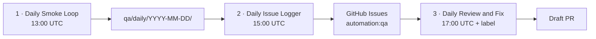

# Daily QA Automations (Cursor)

Three Cursor Automations form a **daily review-and-fix loop** for CampaignOS. They cannot be created from the Cloud Agents API — activate them once at [cursor.com/automations/new](https://cursor.com/automations/new) using the prompts in [`prompts/`](./prompts/).



## Why three automations (not one)

| Automation | Job | Why separate |
| ---------- | --- | ------------ |
| Smoke Loop | Exercise the live app repeatedly | Slow / computer-use heavy; failures should not block logging prior reports |
| Issue Logger | Deduplicate and file GitHub Issues | Stable handoff across days; Memories cannot be shared across automations |
| Review & Fix | Apply only simple, high-confidence fixes | Narrow blast radius; label trigger lets humans promote candidates anytime |

## Prerequisites

1. GitHub connected for Cursor ([Integrations](https://cursor.com/dashboard)).
2. Cloud environment that can `pnpm install` / `pnpm build` for this repo ([Environments](https://cursor.com/dashboard/cloud-agents#environments)).
3. Labels from [`qa/README.md`](../../qa/README.md) created on `triple-dylan/campaignos`.
4. Optional but recommended: secrets for a **read-only test Clerk user** so the smoke agent can enter authenticated routes. Without them, smoke still covers public + signed-out redirect surfaces.

## Create each automation

For **each** of the three prompts:

1. Go to [cursor.com/automations/new](https://cursor.com/automations/new).
2. Name it exactly as in the prompt file heading.
3. Trigger: **Scheduled** with the cron in the table below (or the preset closest to it).
4. **Repository:** single repo `triple-dylan/campaignos`, branch `main` (required — cron defaults to no repo).
5. Paste the prompt from `docs/automations/prompts/*.md` (body only, under `## Prompt`).
6. Tools:
   - All three: **Computer use**, **Memories**
   - Stage 3: **Pull request creation** (default on)
7. Save and enable.

| Automation | Cron (UTC) | Prompt file | Extra trigger |
| ---------- | ---------- | ----------- | ------------- |
| CampaignOS Daily Smoke Loop | `0 13 * * *` | [`01-daily-smoke-loop.md`](./prompts/01-daily-smoke-loop.md) | — |
| CampaignOS Daily Issue Logger | `0 15 * * *` | [`02-daily-issue-logger.md`](./prompts/02-daily-issue-logger.md) | — |
| CampaignOS Daily Review & Fix | `0 17 * * *` | [`03-daily-review-and-fix.md`](./prompts/03-daily-review-and-fix.md) | GitHub **Issue label changed** → `autofix-candidate` |

Staggering gives smoke time to finish and push reports before logging, and logging time to open issues before autofix.

## Auth for deeper loops (optional)

Add Cloud Agent secrets (not committed):

| Secret | Purpose |
| ------ | ------- |
| `QA_TEST_EMAIL` | Clerk test user email |
| `QA_TEST_PASSWORD` | Clerk test user password |
| `NEXT_PUBLIC_APP_URL` | Prefer production URL for smoke against Vercel |

Document the test user as disposable; never use a real campaign account.

## Local helper

```bash
chmod +x scripts/qa-public-smoke.sh
./scripts/qa-public-smoke.sh
./scripts/qa-public-smoke.sh https://campaignos-sigma.vercel.app
```

The smoke automation should run this script first, then continue with browser loops.

## After activation

- Runs appear under [cursor.com/agents](https://cursor.com/agents) with source `automations`.
- Reports land in `qa/daily/YYYY-MM-DD/` on short-lived branches / PRs from the smoke agent (or commits if your automation is configured that way).
- Issues carry `automation:qa`; safe ones also get `autofix-candidate`.
- Autofix opens **draft** PRs that reference the issue.

## Safety bar (autofix)

Only fix when **all** are true:

- Severity is not product-ambiguous
- Change is localized (roughly &lt; ~50 LOC / few files)
- Clear expected behavior from existing tests, types, or adjacent code
- No schema / auth / billing / migration risk without explicit human request

Otherwise leave the issue open with `needs-human` and do nothing else.
