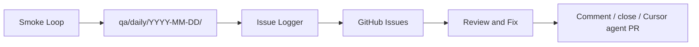

# Daily QA Automations

Three-stage **daily review-and-fix loop** for CampaignOS.

## What actually runs today

GitHub Actions on `main` (owned end-to-end by cloud agents — no manual merge required):

| Workflow | File | Trigger |
| -------- | ---- | ------- |
| Daily QA — Smoke Loop | `.github/workflows/daily-qa-smoke.yml` | Cron `0 13 * * *` UTC + manual |
| Daily QA — Issue Logger | `.github/workflows/daily-qa-issue-logger.yml` | After smoke + cron `0 15 * * *` + manual |
| Daily QA — Review & Fix | `.github/workflows/daily-qa-review-fix.yml` | After logger + cron `0 17 * * *` + `autofix-candidate` label + manual |

Scripts:

- `scripts/qa-smoke-report.mjs` — 3× public production loops → findings
- `scripts/qa-log-issues.mjs` — dedupe + create issues + ensure labels
- `scripts/qa-review-and-fix.mjs` — re-probe, close fixed, optionally launch Cursor Cloud Agent
- `scripts/qa-public-smoke.sh` — bash one-shot public smoke

## Cursor Automations prompts (optional mirror)

Prompts under [`prompts/`](./prompts/) match the same three stages for the Cursor Automations product (`cursor.com/automations`). Creating those dashboard Automations requires a logged-in Cursor session (Connect RPC to `AutomationsService/CreateAutomation`). This cloud VM cannot clear Cloudflare / session auth for that UI, so **Actions are the source of truth that already runs**.

If later `CURSOR_API_KEY` is set as a repo secret, the review workflow launches Cloud Agents for remaining `autofix-candidate` issues.

## Safety bar (autofix)

Only auto-close when production no longer reproduces. Only launch an agent when `CURSOR_API_KEY` is present. Prefer no code change over a risky one (see prompt `03-daily-review-and-fix.md`).
