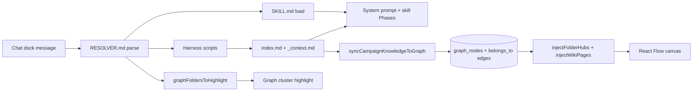

# Campaign knowledge base structure

Audit of the wiki-llm folder tree, harness routing, and graph wiring for out-of-the-box campaigns.

## Current folder tree (what users see)

After onboarding, each campaign gets a wiki-llm tree at `campaign-knowledge/{organizationId}/{campaignId}/` (Supabase Storage by default, or local files when `CAMPAIGN_KNOWLEDGE_STORAGE=local`).

### Root files

| File | Role |
|------|------|
| `AGENTS.md` | Schema + ingest/lint workflows for agents |
| `index.md` | Index-first catalog (rebuilt after writes) |
| `log.md` | Append-only operation history |
| `README.md` | Human orientation |
| `TEMPLATE.md` | Document frontmatter contract |

### Standard folders (20)

All slugs match `CAMPAIGN_FOLDERS` in `src/lib/campaign-knowledge/folders.ts`:

```
campaign/          ← primary hub (candidate profile)
skills/            ← harness SKILL.md mirrors
assets/
initiatives/
events/
fundraising/
accounting/
social-media/
people/
team/
research/
compliance/
messaging/
field/
communications/
vendors/
media/
polling/
endorsements/
ballot-access/
```

Each folder ships with `README.md` + `_context.md`. The `skills/` folder additionally contains mirror stubs for all seven harness skills.

### Seeded on onboarding

| Path | Source | Graph `node_type` |
|------|--------|-------------------|
| `campaign/profile.md` | Campaign row + onboarding basics | `candidate` |
| `messaging/{issue-slug}.md` | Top issues from onboarding | `issue` |
| `people/{segment-slug}.md` | Voter segments from onboarding | `voter_segment` |

Plus all empty folder meta files from the template tree.

## Audit vs wiki-llm / gbrain expectations

| Expectation | Status | Notes |
|-------------|--------|-------|
| 20 standard folders aligned with app modules | ✅ | Templates match `CAMPAIGN_FOLDERS` exactly |
| `index.md` index-first retrieval | ✅ | `rebuildKnowledgeIndex()` maintains page counts |
| `_context.md` per folder | ✅ | Generic boilerplate; `campaign/` enriched with hub guidance |
| `AGENTS.md` schema | ✅ | Ships in template |
| `log.md` append-only | ✅ | Bootstrap appends first entry |
| Document `node_type` frontmatter → graph node | ✅ | `syncCampaignKnowledgeToGraph()` |
| Folder hub nodes in graph | ✅ | `seedFolderHubsForCampaign()` on bootstrap |
| Document `belongs_to` folder hub edges | ✅ Fixed | `linkWikiDocumentsToFolderHubs()` after sync |
| Body wikilink extraction | ⏳ Stub | Only `related[]` frontmatter compiles to edges |
| BM25 / index-first chat retrieval | ⏳ Partial | `list-campaign-context` hydrates index + `_context.md` |
| Skills mirror in `skills/` folder | ✅ | Seven harness skills mirrored in templates |
| RESOLVER.md → skill routing | ✅ | Parsed by `resolver.ts` |
| Runtime context paths (not `templates/`) | ✅ Fixed | `skill-folders.ts` uses `campaign/_context.md` style paths |
| No demo junk in templates | ✅ | "Latino community" only in preview demo graph, not templates |
| Google Drive / external sync | ❌ Not started | See recommended next steps |

## Routing flow: chat → skill → folder → graph



1. **Chat** (`src/actions/chat.ts`) calls `planHarnessTurn()`.
2. **Resolver** (`src/lib/harness/resolver.ts`) matches keywords → skill, loads `contextPaths` from `skill-folders.ts`, sets `graphFoldersToHighlight`.
3. **Scripts** (`runHarnessScripts`) run deterministic lookups — `list-campaign-context` reads live `index.md` and folder `_context.md` when `organizationId` is provided.
4. **Graph highlight** (`resolveRetrievalNodeIds`) picks document nodes in focus folders using `metadata.path`.
5. **Persistence** — onboarding calls `ensureCampaignKnowledgeBootstrapped()` → copies templates, seeds profile/issues/segments → `syncKnowledgeAfterWrite()` seeds hubs, syncs documents, links `belongs_to`.
6. **Render** — `getCampaignGraph()` applies `injectWikiPages()` + `injectFolderHubs()` for sparse DB rows (synthetic hubs/pages at render time, no migration).

## What is wired vs stubbed

| Component | Wired | Stub / future |
|-----------|-------|---------------|
| Template bootstrap | ✅ | — |
| Supabase Storage backend | ✅ | — |
| Graph sync from wiki frontmatter | ✅ | Body wikilinks |
| Folder hub seeding | ✅ | — |
| `belongs_to` document → hub | ✅ | — |
| Harness resolver + skill loader | ✅ | `check-resolvable` validation |
| Chat harness turn | ✅ | Full BM25 over wiki |
| `list-research-context` | Partial | Reads templates, not runtime tree |
| `generate-from-skill` | Stub | Calls flow metadata only |
| Google Drive mirror | ❌ | — |
| Wiki lint/repair job | ❌ | — |

## Related docs

- [wiki-llm folder structure](../architecture/wiki-llm-folder-structure.md)
- [gbrain + wiki-llm baseline](../research/gbrain-wiki-llm-baseline.md)
- [Harness README](../../src/lib/harness/README.md)

## Recommended next steps

1. **Google Drive sync mirror** — optional `raw/` + export of `campaign-knowledge/` for user-owned backups.
2. **Body wikilink parser** — deterministic `[[folder/page]]` extraction on write (Gbrain `link-extraction` pattern).
3. **Runtime `list-research-context`** — read from Supabase Storage, not shipped templates.
4. **`pnpm harness:check-resolvable`** — validate RESOLVER.md reachability vs skill frontmatter triggers.
5. **Wiki lint job** — orphans, missing `node_type`, stale index counts.
