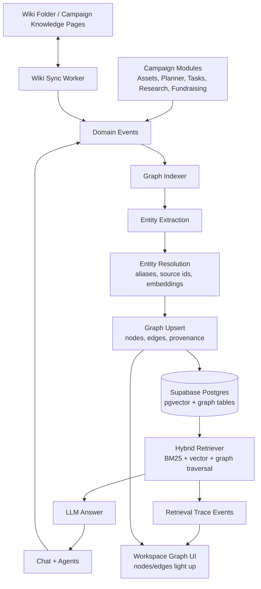

# Dynamic Knowledge Graph Research Brief

## Executive Summary

CampaignOS should implement a dynamic campaign knowledge graph as a hybrid of three layers:

1. **Canonical campaign object graph** in Supabase: candidates, issues, voters, people, orgs, assets, events, research, tasks, donors, compliance items, and strategic priorities.
2. **Document/wiki layer**: folder-based markdown or database-backed "wiki pages" that summarize durable campaign knowledge, expose backlinks, and map naturally to Obsidian-style graph nodes.
3. **Retrieval activity layer**: transient retrieval traces emitted while users chat or agents work, used to light up nodes/edges and explain which path informed an answer.

The existing CampaignOS schema and UI are a strong MVP foundation. The next step should not be a separate graph database. Use Postgres/Supabase first: add provenance, document chunks, entity aliases, graph update jobs, and retrieval traces. Consider Neo4j/Kuzu/Cytoscape/WebGL later only if graph traversal, analytics, or visualization scale outgrow Postgres + pgvector.

## Architecture



## Recommended Data Model

Keep `graph_nodes` and `graph_edges`, but evolve them.

### Node Types

Core:
- `candidate`
- `campaign`
- `issue`
- `voter_segment`
- `message_theme`
- `strategic_priority`
- `opponent`

People and organizations:
- `person`
- `donor`
- `prospect`
- `volunteer`
- `staffer`
- `endorser`
- `organization`
- `media_outlet`
- `union`
- `business`
- `committee`

Work products:
- `asset`
- `research`
- `event`
- `task`
- `compliance`
- `wiki_page`
- `source_document`
- `chunk`

Political operations:
- `precinct`
- `district`
- `jurisdiction`
- `poll`
- `canvass_turf`
- `fundraising_goal`
- `call_time_block`

### Edge Types

Campaign semantics:
- `supports`
- `opposes`
- `targets`
- `aligns_with`
- `belongs_to`
- `references`
- `derived_from`
- `created_from`
- `scheduled_for`
- `assigned_to`
- `requires_review`
- `mentions`
- `cites`
- `contradicts`
- `updates`
- `same_as`
- `has_alias`
- `located_in`
- `donated_to`
- `endorses`
- `attended`
- `authored_by`

### Provenance Fields

Add or model:
- `source_object_type`
- `source_object_id`
- `source_document_id`
- `chunk_id`
- `span_start`
- `span_end`
- `created_by_agent_run_id`
- `confidence`
- `extraction_method`
- `last_seen_at`
- `superseded_at`
- `review_status`

## Dynamic Construction

Use an append-friendly graph indexer.

1. Domain object created or updated.
2. Event emitted with object type, ID, content, campaign ID.
3. Indexer chunks text and stores source provenance.
4. Extract entities, candidate links, and typed relationships.
5. Resolve entities by source ID, exact normalized title, aliases, embedding similarity, then LLM adjudication for ambiguous matches.
6. Upsert canonical nodes and edges.
7. Mark old object-derived edges stale if no longer supported.
8. Emit graph update and retrieval/UI events.

Deduplication should be tiered:
- Strong match: same `source_object_type/source_object_id`.
- Strong match: same canonical slug inside same campaign and node type.
- Medium match: alias match, normalized title, known campaign namespace.
- Weak match: embedding similarity plus LLM confirmation.
- Manual queue: politically sensitive merges such as donors, opponents, compliance claims.

## Retrieval + Graph Sync

Recommended retrieval pipeline:
1. Parse user query into intents and entity hints.
2. Run hybrid search over:
   - graph node titles/summaries,
   - source chunks,
   - wiki page summaries,
   - BM25 keyword matches,
   - pgvector embeddings.
3. Expand from high-confidence seed nodes by 1-2 hops.
4. Rank paths by relevance, recency, confidence, and campaign importance.
5. Send answer context with citations and graph path metadata.
6. Stream retrieval trace events to UI:
   - `node_searched`
   - `edge_traversed`
   - `chunk_read`
   - `node_used`
   - `answer_citation`

The "thinking" visualization should move from simulated BFS to real retrieval traces.

## Folder/Wiki Pattern

Adopt an LLM-wiki structure conceptually:

```text
campaign-knowledge/
  SCHEMA.md
  index.md
  log.md
  raw/
    uploads/
    research/
    transcripts/
  wiki/
    people/
    organizations/
    issues/
    voter-segments/
    messages/
    events/
    assets/
    compliance/
```

Each wiki page maps to a `wiki_page` graph node. Wikilinks like `[[Affordable Housing]]` create `mentions` or typed inferred edges. CampaignOS can store pages in Postgres first and optionally export/import markdown folders later.

GBrain finding: Garry Tan's GBrain is directly relevant. It is markdown-first, self-wiring, and uses wikilinks/typed links to build graph edges, with hybrid retrieval over vector, BM25, and graph traversal. The useful CampaignOS lesson is: make the campaign wiki the durable human/agent-readable memory layer, and make the graph an index derived from object records + links + extracted entities.

## Visualization

MVP:
- Continue React Flow for 0-200 visible nodes.
- Prefer local graph views centered on selected node or retrieval path.
- Keep global graph as an audit/exploration mode, not the main daily interface.

Scale:
- For 200-500 nodes, add filters, clustering, hidden labels, local-depth controls, and server-side subgraph queries.
- For 500-1000+ nodes, evaluate Canvas/WebGL renderers such as `react-force-graph`, Cytoscape.js, or Sigma.js.
- Avoid rendering every node by default. Obsidian-style global graphs become hairballs quickly.

## Event Flow

User creates asset:
1. `createAsset` writes `assets`.
2. Graph indexer creates/updates an `asset` node.
3. Asset content is chunked and embedded.
4. Entity extraction finds issues, voter segments, people, orgs, and message themes.
5. Entity resolver links to canonical nodes.
6. Edges are upserted: `asset -> derived_from -> message_theme`, `asset -> targets -> voter_segment`, `asset -> references -> issue`.
7. Workspace graph receives update and adds/animates new node.
8. Later chat asks, "What should this mailer emphasize?"
9. Retriever finds asset chunk, traverses to issue/theme/segment nodes, emits path.
10. UI lights up the asset, issue, theme, and voter segment path while answer is generated.

## Implementation Phases

### Phase 1: Strengthen Current Graph
- Add unique constraints for source object nodes.
- Add edge idempotency.
- Add aliases/canonical slugs.
- Add `updated_at`, `last_seen_at`, and stale/superseded handling for edges.
- Improve exact dedupe for Campaign Brain message themes.

### Phase 2: Provenance + Chunks
- Add `source_documents`, `document_chunks`, and `graph_provenance`.
- Embed chunks and graph node summaries.
- Link graph facts to chunks or source objects.
- Add citations to node detail sheets.

### Phase 3: Graph-Aware Chat Retrieval
- Replace node-count-only chat context with hybrid retrieval.
- Return retrieval trace metadata from `sendChatMessage`.
- Highlight actual retrieved nodes/edges in `WorkspaceGraphCanvas`.

### Phase 4: Wiki Layer
- Add campaign wiki pages with structured frontmatter.
- Support wikilinks/backlinks.
- Sync wiki pages to graph nodes/edges.
- Generate/update durable issue, people, org, and message pages from agent work.

### Phase 5: Real-Time Dynamic Graph
- Add Supabase Realtime or an app-level event stream for graph updates.
- Stream retrieval events while chat/agents run.
- Add graph update jobs for scheduled automations.

### Phase 6: Scale + Analytics
- Add local graph query endpoint.
- Add clusters/communities.
- Add graph health audits: orphan nodes, stale claims, missing sources.
- Move visualization to Canvas/WebGL if needed.

## Open Questions / Tradeoffs

- Is the source of truth campaign domain tables, wiki pages, or graph nodes? Recommendation: domain tables + wiki pages are sources of truth; graph is a query/index layer.
- Should CampaignOS use a graph database? Not yet. Postgres is enough for MVP and avoids operational complexity.
- Should LLMs create every edge? No. Prefer deterministic edges from module fields and wikilinks, then use LLM extraction for unstructured content.
- How much should the graph mutate from chat? Chat should write durable graph facts only when the agent creates or updates campaign knowledge, not every casual exchange.
- How should sensitive political data be handled? Donor/person/opponent/compliance entity merges need conservative dedupe, provenance, review states, and audit logs.
